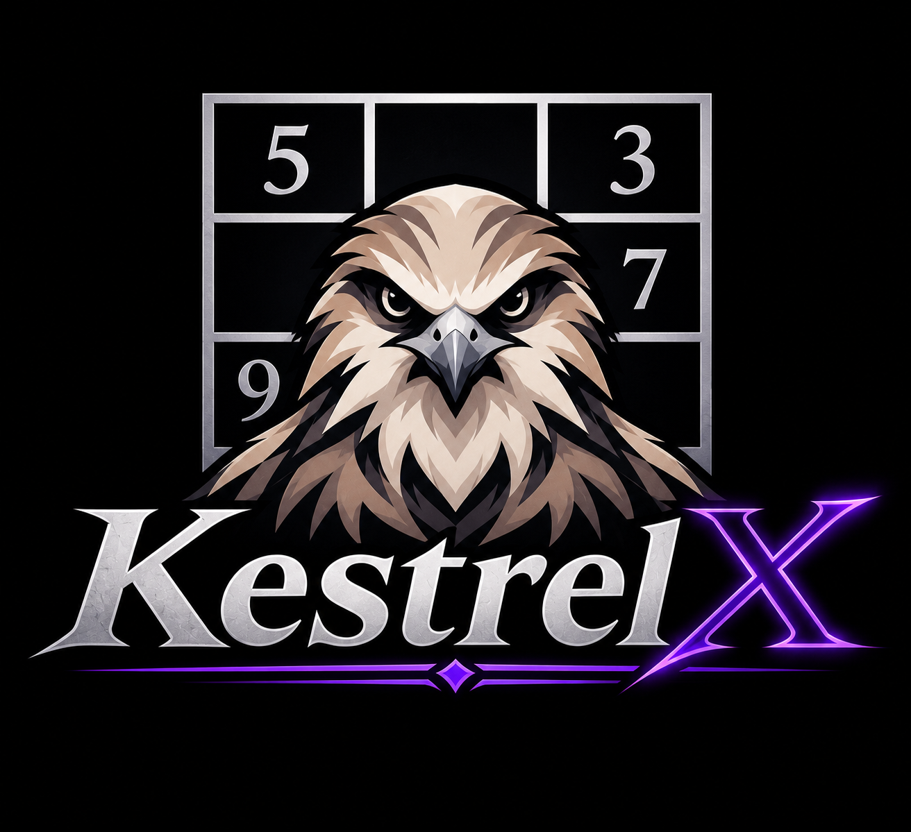
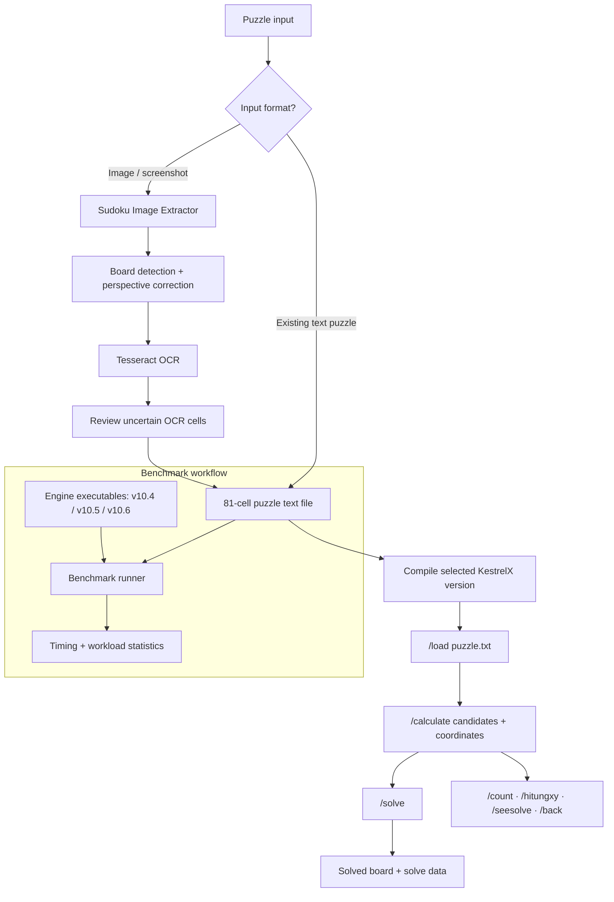
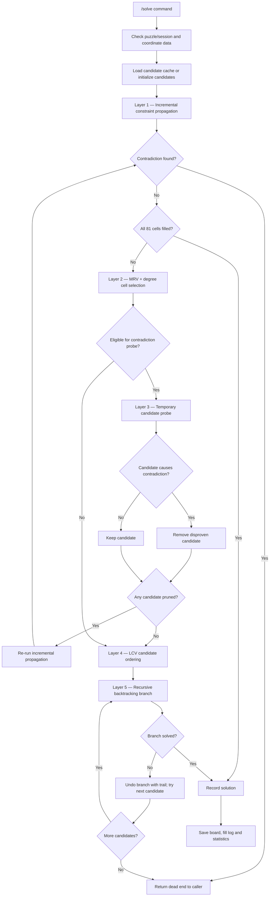

<p align="center">
  
</p>

<h1 align="center">KestrelX</h1>

<p align="center">
  <strong>A C++ Sudoku-solving engine with image extraction and performance benchmarking tools.</strong><br>
  From a Sudoku image or text puzzle to candidate analysis, solving, and version comparison.
</p>

<p align="center">
  
  
  
  
  
</p>

---

**KestrelX** is the Sudoku-solving engine in the `Sudoku-KestrelX-` repository. The repository also contains two supporting utilities: an image-to-puzzle extractor and a benchmark runner for comparing engine executables.

The documented engine line currently includes **v10.4**, **v10.5**, and **v10.6**. The v10.6 source is the newest version represented in this repository; this does **not** mean it has been declared a stable production release. The project is still under active development.

## Project overview

| Component | Responsibility |
|---|---|
| **KestrelX Sudoku Engine** | Loads puzzle text, validates givens, calculates candidate/coordinate data, solves Sudoku, counts solutions, and supports cell inspection. |
| **Sudoku Image Extractor** | Uses OpenCV image processing and Tesseract OCR to detect a Sudoku board and produce an 81-cell text puzzle, alongside visual review images. |
| **Benchmark System** | Runs one or more engine executables against puzzle files and reports timing and solver-workload statistics. |

## Architecture

The diagram below shows the intended workflow and the separate benchmark path. The image-extraction stage is optional when a puzzle is already available as text.



### How the workflow operates

1. **Provide a puzzle.** Start with an image or a text file containing the puzzle data.
2. **Extract, if needed.** The image extractor detects the board, corrects perspective, and reads the cells with OCR. Inspect the generated review image when a cell is marked uncertain or the extracted digits do not match the source.
3. **Build an engine executable.** Choose one of the versioned C++ source files.
4. **Load and calculate.** Use `/load` followed by `/calculate` to load the puzzle and prepare coordinate/candidate data.
5. **Solve and inspect.** Run `/solve`; use the other interactive commands to inspect or validate the result.
6. **Benchmark versions.** Run the benchmark utility with the same puzzle data and selected engine executables to compare their reported measurements.

### Inside the solve process — v10.6, layer by layer

The following description follows the implementation in `VersionRelease/Engine_Ver_10_6.cpp`. It describes the solver's actual sequence, not a generic Sudoku algorithm. The image extractor is outside this path: `/solve` receives the already-loaded 81-cell puzzle.



#### Layer 0 — Entry checks and candidate state

When `/solve` is called, the program first checks that the puzzle is not empty and that the session's coordinate data file exists. If the coordinate data is missing, it runs the calculate step and asks the user to issue `/solve` again. The solver then uses the candidate cache when it belongs to the active session; otherwise it builds candidate masks from the current board.

Each empty cell stores its possible digits in a `uint16_t` bitmask. Given digits are excluded from the masks of their 20 peer cells (cells sharing the same row, column, or 3×3 box). This compact representation makes candidate membership, removal, and candidate counting efficient.

#### Layer 1 — Incremental constraint propagation

`propagasiIncremental()` tries to make progress through logical deductions before guessing. It maintains unit/digit position data (UDP), a worklist of affected units (`dirtyUnits`), a separate worklist for locked-candidate checks, and queued row/column work for X-Wing. When a cell or candidate changes, only the related row, column, and box are marked for re-evaluation rather than blindly rescanning every unit.

Within the affected units, the engine applies these techniques:

1. **Naked Single:** if an empty cell has exactly one candidate, that digit is placed in the cell.
2. **Hidden Single:** if a digit has only one remaining position in a row, column, or box, it is placed there. UDP tracks the candidate positions used for this check.
3. **Naked Pair, Triple, and Quad:** when two, three, or four cells in one unit collectively contain exactly two, three, or four digits, those digits are removed from the other cells in that unit.
4. **Locked Candidates:** pointing and claiming patterns remove a digit from cells outside the intersecting box/row/column where the pattern confines that digit.
5. **X-Wing:** matching two-position patterns across two rows or two columns eliminate the corresponding digit from other cells in those columns or rows.

Every placement or elimination updates the candidate-position data and marks affected units/patterns dirty. The worklists are processed again until no new locked-candidate or X-Wing changes remain. If an empty cell loses all candidates, or a digit has no possible position in a unit where it has not already been placed, propagation reports a contradiction. The caller then treats that search branch as a dead end.

#### Layer 2 — Decision cell selection (MRV + degree)

If propagation does not solve the board, `cariSelMRV()` chooses an empty cell with the **Minimum Remaining Values (MRV)** rule: prefer the cell with the fewest candidates. When cells tie on candidate count, the implementation prefers the one with the larger degree, meaning it has more unfilled peer cells. This focuses the next decision on a constrained cell that also affects many unresolved neighbours.

A cell with zero candidates is immediately treated as a dead end. If the board is complete, the solver records the solution instead of making another decision.

#### Layer 3 — Selective contradiction probe (v10.5, refined in v10.6)

Before branching, v10.6 checks whether the selected MRV cell is eligible for a temporary look-ahead test. The gate is deliberately selective:

- **2 candidates:** probe only when the cell's degree is at least 8.
- **3 candidates:** probe only when the degree is at least 12.
- Other candidate counts: skip this probe.

For each candidate being tested, `probeContradiction()` temporarily assumes that value and performs three bounded checks:

1. **Peer elimination:** remove the assumed digit from the selected cell's 20 peers and detect an empty candidate mask.
2. **Naked Single cascade:** process newly created naked singles through a deduplicated queue (`queued[81]`), propagate their peer eliminations, and detect another empty mask.
3. **Local unit feasibility:** check the selected cell's row, column, and box to ensure every digit not yet placed still has at least one possible location.

If this temporary test finds a contradiction, the tested candidate is removed from the real candidate set. If it does not, the candidate remains available; the probe is a bounded filter, not a proof that the candidate leads to a complete solution. All temporary board and mask changes made during each probe are restored using the trail mechanism.

If one or more candidates are removed, v10.6 runs incremental propagation again on the changed state and returns to the decision cycle: check completion, recompute MRV, and evaluate probe eligibility again. This re-propagation loop is an important part of the v10.6 decision cycle. If the probe removes no candidate, the solver proceeds to candidate ordering.

#### Layer 4 — Candidate ordering with LCV

When a branch is needed, the engine orders the selected cell's remaining candidates using **Least Constraining Value (LCV)**. `hitungEliminasiLCV()` counts how many peer cells currently contain each candidate. Candidates are tried in ascending elimination count, so the value that immediately removes fewer options from neighbouring cells is attempted first.

LCV changes the order in which alternatives are explored; it does not eliminate a candidate by itself.

#### Layer 5 — Recursive backtracking and rollback

For each candidate in LCV order, the solver creates a branch by placing that value temporarily, removing it from the 20 peers, and recursively calling `solveCerdas()` on the resulting state. The recursive call repeats the same cycle: propagation, completion/contradiction checks, MRV selection, selective probe, LCV ordering, and deeper branching when necessary.

If a branch reaches a contradiction or cannot produce a solution, the solver restores the board and candidate masks to the branch's saved trail position (`trailUndo()`), restores the step counter, and tries the next candidate. This rollback prevents deductions from a failed branch from leaking into another branch. If a branch succeeds, the first solution and its fill log are retained. The `/solve` command requests one solution; the separate `/count` path can request a bounded count of solutions.

#### Final layer — Result, log, and measurements

After a solution is found, `/solve` displays the solved board and writes `data_solve_<session>.txt`. The output includes the solved board, fill log, solve time, propagation/elimination/guess counts, dead-end and retry counts, technique statistics, and technique timing. These are measurements from that run; they should not be interpreted as a general speed guarantee without repeatable benchmarks on a documented puzzle set and machine.

**Important scope note:** the contradiction probe is intentionally narrower than the full propagation layer. It checks peer eliminations, a bounded Naked Single cascade, and feasibility in the selected cell's three units. It does not run the complete Naked Subset / Locked Candidate / X-Wing propagation suite inside every probe. The full incremental propagation routine runs at the normal solver layer and is re-run after a successful probe prune.

1. **Provide a puzzle.** Start with an image or a text file containing the puzzle data.
2. **Extract, if needed.** The image extractor detects the board, corrects perspective, and reads the cells with OCR. Inspect the generated review image when a cell is marked uncertain or the extracted digits do not match the source.
3. **Build an engine executable.** Choose one of the versioned C++ source files.
4. **Load and calculate.** Use `/load` followed by `/calculate` to load the puzzle and prepare coordinate/candidate data.
5. **Solve and inspect.** Run `/solve`; use the other interactive commands to inspect or validate the result.
6. **Benchmark versions.** Run the benchmark utility with the same puzzle data and selected engine executables to compare their reported measurements.

## Quick start

### 1. Requirements

- A C++17-compatible compiler such as `g++`.
- Linux, Ubuntu/Debian, or WSL is the documented setup target for the helper installer and benchmark runner.
- OpenCV and Tesseract OCR for the image extractor.
- `pkg-config` for the convenient OpenCV build command, where the installed OpenCV package provides a matching `.pc` file.

The dependency script in this repository builds OpenCV from its `5.x` branch and installs Tesseract. OpenCV package names and `pkg-config` metadata can vary by installation; check the installed environment before compiling.

### 2. Install image-extractor dependencies (optional)

Run from the repository root:

```bash
bash UtilsHelper/setup_dependencies.sh
```

The script targets Ubuntu/Debian/WSL and uses `sudo` internally when required. Read the script before running it and confirm that its package and system changes are appropriate for your environment.

### 3. Compile KestrelX

For the newest source included in this repository:

```bash
g++ -std=c++17 -O3 VersionRelease/Engine_Ver_10_6.cpp -o kestrelx
```

To build another documented version, replace the source filename:

```bash
g++ -std=c++17 -O3 VersionRelease/Engine_Ver_10_5.cpp -o kestrelx-10.5
g++ -std=c++17 -O3 VersionRelease/Engine_Ver_10_4.cpp -o kestrelx-10.4
```

### 4. Compile the image extractor (optional)

If `pkg-config` can locate your OpenCV installation:

```bash
g++ -std=c++17 -O3 UtilsHelper/Capture_Data_From_Image.cpp \
  -o kestrelx-extractor \
  $(pkg-config --cflags --libs opencv4)
```

If your OpenCV installation exposes a different package name, use the corresponding package name reported by `pkg-config --list-all` and the include/library paths for that installation. The repository's setup script builds OpenCV 5, while the exact `pkg-config` module name may differ by packaging; this command may need adjustment for your environment.

### 5. Compile the benchmark runner

```bash
g++ -std=c++17 -O3 UtilsHelper/Benchmark_Test_Engine.cpp -o kestrelx-benchmark
```

The benchmark implementation uses POSIX process APIs, so the documented helper is intended for Unix-like environments.

## Using the engine

Start the executable:

```bash
./kestrelx
```

Then use the interactive commands:

| Command | Purpose |
|---|---|
| `/load <file>` | Load a text puzzle file and initialize its session data. |
| `/calculate` | Build coordinate and candidate data. Run this before solving if it has not already been prepared. |
| `/solve` | Run the solving process and save the solve output. |
| `/count` | Count possible solutions, up to the engine's configured limit. |
| `/hitungxy` | Inspect a cell using the engine's X/Y coordinate convention. |
| `/seesolve` | Display the solved board after a successful solve. |
| `/back` | Return the display to the original puzzle. |
| `/quit` | Exit the engine. |

See [`GUIDE.md`](GUIDE.md) for the detailed interactive workflow and expected output files.

## Image extraction

Build and run the extractor after installing OpenCV:

```bash
./kestrelx-extractor
```

The program prompts for an image path and an output filename. According to the project guide, it produces:

- a text puzzle file containing 81 cell values (`0` represents an empty cell);
- a `*_grid.png` review image showing board/grid detection and perspective correction;
- a `*_hasil.png` review image showing OCR results for individual cells.

OCR is not guaranteed to be correct for every image. Check the generated review image and compare the extracted puzzle with the original image before solving, especially when the source is small, blurry, tilted, or poorly lit.

## Benchmarking

Build and run the benchmark utility:

```bash
./kestrelx-benchmark
```

The interactive runner asks for engine executable paths, puzzle files, warm-up count, and benchmark run count. It performs a pre-flight check for the session/coordinate data and reports measurements such as minimum, median, mean, maximum, and standard deviation, along with solver-workload statistics described in `GUIDE.md`.

For meaningful comparisons, use the same puzzle inputs and record the machine, compiler, build flags, warm-up count, and run count. Benchmark output can vary with hardware, compiler, build configuration, and system load.

## Version history

| Version | Codename | Main documented focus |
|---|---|---|
| **v10.4** | Hot Path Optimization | Bitmask-based candidate handling and incremental propagation-oriented performance work. |
| **v10.5** | Adaptive MRV Contradiction Probe | Probe candidate choices to detect contradictions before branching. |
| **v10.6** | Precision Decision Cycle | Selective probe eligibility, re-propagation after successful pruning, and queue deduplication. |

See [`VersionRelease/VERSIONS.md`](VersionRelease/VERSIONS.md) for the source-level version notes. These descriptions summarize the project's documented design; they are not independent performance guarantees.

## Repository layout

```text
.
├── README.md
├── GUIDE.md
├── SPEC.md
├── LICENSE
├── .gitignore
├── STABLE_VER
├── docs/
│   └── assets/
│       └── kestrelx-logo.png
├── UtilsHelper/
│   ├── Benchmark_Test_Engine.cpp
│   ├── Capture_Data_From_Image.cpp
│   └── setup_dependencies.sh
└── VersionRelease/
    ├── Engine_Ver_10_4.cpp
    ├── Engine_Ver_10_5.cpp
    ├── Engine_Ver_10_6.cpp
    └── VERSIONS.md
```

## Development status

<details>
<summary><strong>Under development — current limitations and next steps</strong></summary>

KestrelX is an active development project. The presence of versioned source files and helper utilities does not establish that the complete image-to-solution pipeline has passed a comprehensive validation process.

Items to verify and improve include:

- document the supported compiler, C++ standard, OpenCV version, and Tesseract version consistently;
- align build commands with the actual installed OpenCV package metadata;
- add repeatable end-to-end tests from image extraction through solving;
- evaluate OCR accuracy across image sizes, lighting, perspective, and board styles;
- validate solver correctness on a documented set of puzzles with known solutions;
- store raw benchmark results with environment and build details;
- define explicit release criteria and update `STABLE_VER` only when a stable version is formally selected.

`STABLE_VER` is empty in the supplied project archive. Therefore, this README does not declare v10.6 (or any other version) as a stable release.

</details>

## Contributing

Contributions and issue reports are welcome. When proposing a change:

1. Describe the affected component (engine, image extractor, or benchmark system).
2. Include a minimal reproducible puzzle or image example when possible.
3. Record compiler, dependency versions, and build flags.
4. Include before/after benchmark data for performance-related changes.
5. Avoid committing generated binaries, private data, or unrelated local files.

## License

This project is licensed under the **MIT License**. See [`LICENSE`](LICENSE) for the full text.

---

<p align="center">
  <sub>Developed as part of the DeepMindTeam project ecosystem.</sub>
</p>
